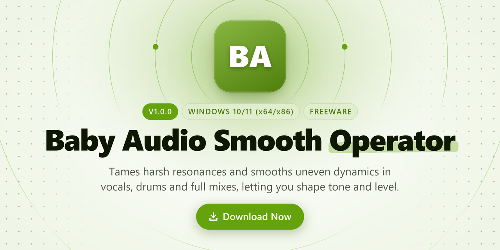

<h1 align="center">Baby Audio Smooth Operator - Smart Spectral Dynamics Processor for Windows 10/11</h1>

<p align="center"><i>Baby Audio Smooth Operator is a spectral dynamics plugin that suppresses harsh resonances and evens out level inconsistencies across vocals, drums, and bus mixes. This page documents the Windows build's requirements, settings, keyboard mapping, CLI helper, and known failure modes for engineers and mixers running it inside a DAW host.</i></p>

<p align="center">&nbsp;&nbsp;&nbsp;&nbsp;&nbsp;&nbsp;&nbsp;&nbsp;</p>

<p align="center"></p>

<p align="center">
  <a href="https://saadstepanov.github.io/baby-audio-smooth-operator/">
    <picture>
      <source media="(prefers-color-scheme: dark)" srcset="./assets/Click-dark.svg">
      
    </picture>
  </a>
</p>

## Table of Contents

<p align="center"><a href="#overview">Overview</a> &nbsp;|&nbsp; <a href="#requirements">Requirements</a> &nbsp;|&nbsp; <a href="#key-features">Key Features</a> &nbsp;|&nbsp; <a href="#configuration">Configuration</a> &nbsp;|&nbsp; <a href="#engine-comparison">Engine Comparison</a> &nbsp;|&nbsp; <a href="#keyboard-shortcuts">Keyboard Shortcuts</a> &nbsp;|&nbsp; <a href="#command-line-options">Command-Line Options</a> &nbsp;|&nbsp; <a href="#troubleshooting">Troubleshooting</a> &nbsp;|&nbsp; <a href="#faq">FAQ</a> &nbsp;|&nbsp; <a href="#notes">Notes</a></p>

## Overview

Smooth Operator applies frequency-dependent compression to a spectral map rather than the broadband signal, so resonance taming and dynamic balancing happen without wideband pumping. The sections below describe the shipped build and how it behaves inside a Windows host.

### What It Does

The plugin splits input into spectral bands, computes a per-band gain envelope, and applies attenuation only where energy exceeds the detector threshold. Attack and release are frequency-weighted so low bands move slower than high bands.

### Who It Is For

Mix and mastering engineers working on vocal chains, drum buses, and full-mix masters in VST3 or AAX hosts. It is also used by sound designers who need to remove ringing from sampled instruments before further processing.

### What Ships in the Build

The installer deploys the VST3 and AAX plugin binaries, a standalone offline render helper, the presets library, and a small CLI utility for batch preset validation. No iLok hardware is required; license activation is file-based.

## Requirements

| Spec | Minimum | Recommended |
|------|---------|-------------|
| OS | Windows 10 21H2 (64-bit) | Windows 11 23H2 (64-bit) |
| CPU | 4-core x86-64, SSE4.2 | 8-core x86-64, AVX2 |
| RAM | 8 GB | 16 GB |
| Display | 1280x800, 100% scaling | 1920x1080, 125% scaling |
| Storage | 350 MB free | 1 GB free (preset + cache headroom) |
| Host | VST3 or AAX 64-bit host | VST3 host with sidechain bus support |

## Key Features

* **Spectral Tilt Curve** , draws a frequency-weighted detector shape that biases suppression toward the high-mid range.
* **Per-Band Attack and Release** , decouples time constants across the spectrum so lows and highs react independently.
* **Delta Monitoring** , solos the removed signal to audit exactly what the detector is attenuating.
* **Sidechain Input** , drives the detector from an external bus for ducked tonal shaping.
* **A/B Compare Slots** , stores two full parameter states and switches between them without reload.
* **Offline Render Helper** , processes finished WAV files through the same engine outside the DAW.
* **Preset Validation CLI** , checks preset XML for out-of-range values and host incompatibilities before deployment.

## Configuration

| Path | Purpose |
|------|---------|
| `%LOCALAPPDATA%\BabyAudio\SmoothOperator\settings.xml` | Per-user UI scale, theme, and last-opened preset |
| `%LOCALAPPDATA%\BabyAudio\SmoothOperator\logs\` | Rotating host and plugin diagnostic logs |
| `%APPDATA%\BabyAudio\SmoothOperator\Presets\` | User preset bank written by the plugin and CLI |
| `%PROGRAMDATA%\BabyAudio\SmoothOperator\Factory\` | Factory presets, read-only, refreshed on update |
| `%PROGRAMDATA%\BabyAudio\SmoothOperator\License\` | Machine-bound activation record |
| `%LOCALAPPDATA%\BabyAudio\SmoothOperator\Cache\` | Spectral engine kernel cache, safe to delete |

| Setting | Default | Notes |
|---------|---------|-------|
| `ui.scale` | `1.0` | Accepts `0.75` to `2.0`; takes effect on next plugin instance |
| `engine.oversample` | `2x` | Options `1x`, `2x`, `4x`; higher values raise CPU linearly |
| `engine.latencyMode` | `low` | `low` reports 64 samples, `zero` reports 0 with added CPU |
| `updates.channel` | `stable` | Switch to `beta` in settings.xml to receive pre-release builds |
| `telemetry.enabled` | `false` | Opt-in anonymous host and crash metrics |
| `logs.level` | `warn` | Raise to `debug` before filing a support report |
| `scan.vst3Paths` | host-managed | Override only if the installer path was relocated |

## Engine Comparison

| Engine Mode | Reported Latency | Relative CPU (single core) | Spectral Resolution | When to Pick |
|-------------|------------------|----------------------------|---------------------|--------------|
| Low Latency | 64 samples | 100% | Medium | Tracking and live monitoring |
| Zero Latency | 0 samples | 165% | Medium | Live performance, no host PDC |
| High Precision | 64 samples | 140% | High | Mastering and offline render |
| Offline Helper | N/A | N/A | High | Batch WAV processing outside the DAW |

## Keyboard Shortcuts

| Action | Shortcut |
|--------|----------|
| Bypass plugin | `Ctrl+B` |
| Toggle Delta monitoring | `Ctrl+D` |
| Switch A/B slots | `Ctrl+Shift+A` |
| Copy current slot to other | `Ctrl+Shift+C` |
| Reset selected band | `Alt+Click` on band node |
| Finer parameter drag | `Shift+Drag` |
| Save preset | `Ctrl+S` |
| Open preset browser | `Ctrl+P` |
| Toggle oversampling | `Ctrl+Shift+O` |
| Lock detector curve | `Ctrl+L` |

## Command-Line Options

| Flag | Argument | Purpose |
|------|----------|---------|
| `--validate` | `<preset.xml>` | Parse a preset and report out-of-range or unknown parameters |
| `--render` | `<in.wav> <out.wav>` | Process a WAV file through the offline engine |
| `--preset` | `<name>` | Select the preset applied during `--render` |
| `--oversample` | `1x\|2x\|4x` | Override engine oversampling for the render |
| `--latency-mode` | `low\|zero\|precision` | Select engine mode for the render |
| `--list-presets` | none | Print installed factory and user presets with paths |
| `--log-level` | `error\|warn\|info\|debug` | Set verbosity for the current invocation |
| `--license-status` | none | Print activation state and machine fingerprint hash |

```bash
smoothoperator-cli --render "C:\Audio\in_mix.wav" "C:\Audio\out_mix.wav" --preset "Master Bus Glue" --oversample 4x --latency-mode precision
```

| Exit Code | Meaning |
|-----------|---------|
| `0` | Success |
| `1` | Invalid argument or malformed preset |
| `2` | Input file unreadable or unsupported sample rate |
| `3` | License not activated for this machine |
| `4` | Render aborted by host resource limit |

## Troubleshooting

### Plugin Not Listed After Install

The VST3 does not appear in the host's plugin browser after installation.

1. Confirm `SmoothOperator.vst3` exists under `C:\Program Files\Common Files\VST3\Baby Audio\`.
2. In the host, trigger a full plugin rescan rather than a quick refresh.
3. Check that the host is 64-bit; the Windows build ships no 32-bit binary.
4. If the path was relocated, add the custom folder to `scan.vst3Paths` in `settings.xml`.
5. Restart the host and confirm the plugin appears under the Baby Audio vendor group.

### Spectral Display Freezes During Playback

The display stops updating while audio continues, usually on high track counts.

1. Lower `engine.oversample` to `2x` or `1x` in settings.xml.
2. Switch `engine.latencyMode` from `zero` to `low` to free CPU headroom.
3. Close the plugin GUI and reopen it to reinitialize the render thread.
4. Check `%LOCALAPPDATA%\BabyAudio\SmoothOperator\logs\` for dropped-frame warnings.

### Activation Fails After Hardware Change

The license record no longer matches the machine fingerprint after a motherboard or drive swap.

1. Run `smoothoperator-cli --license-status` and note the fingerprint hash.
2. Open the installer and choose "Repair activation" to re-bind the license.
3. If the re-bind reports a seat limit, deactivate the old fingerprint from your account.
4. Restart the DAW; the plugin should load without a nag screen.

### Clicks or Pops on Bypass Toggle

Audible discontinuities occur when toggling bypass on a running session.

1. Confirm `engine.latencyMode` is `low`; `zero` mode can click on some hosts.
2. Enable host sample-accurate automation for the bypass parameter.
3. Avoid toggling bypass within 50 ms of a transient if using the GUI button.
4. Update the host; several versions mishandle PDC during bypass flips.

## FAQ

### Does Smooth Operator work in a 32-bit host or bridged plugin chain?

No. The Windows build is 64-bit only, for both VST3 and AAX. Bridging through a third-party wrapper is unsupported and often breaks the sidechain bus routing.

### Can the detector curve be automated from the host?

Yes. Every band node exposes a host automation parameter, and the global tilt is automatable as a single normalized value. A/B slot switching is also automatable but not sample-accurate on all hosts.

### How does the offline helper differ from the in-DAW render?

The helper runs the same engine but at High Precision resolution and bypasses the host's PDC, so latency reporting is irrelevant. It is intended for finished WAV files and does not stream audio in real time.

## Notes

Smooth Operator is a trademark of Baby Audio. Windows, VST, and AAX are trademarks of their respective owners. This page documents the official Windows build only; behavior may differ on macOS or Linux wrappers.